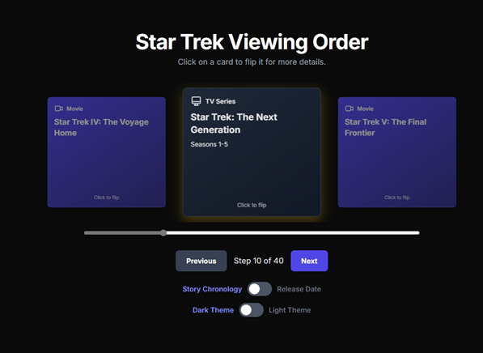
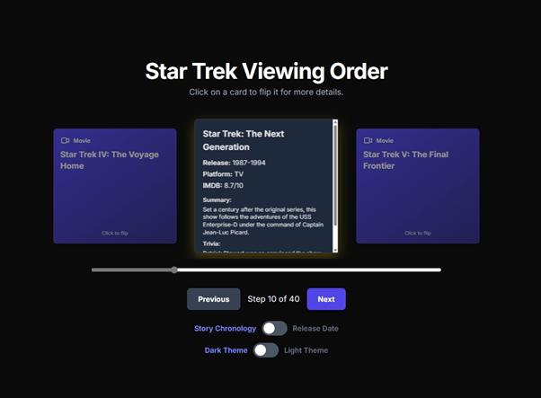
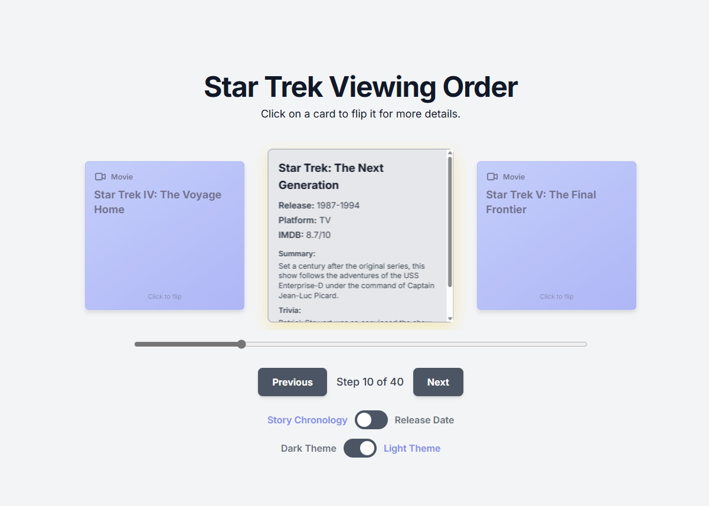

# ⭐ Interactive Star Trek Viewing Order

Welcome to the **Star Trek Viewing Order** project! This interactive timeline helps fans explore the Star Trek universe in both story chronology and release order, with beautiful flip cards, theme toggles, and a modern responsive design.





## 🚀 Features
- **Interactive Timeline Carousel**: Flip through series, movies, and crossovers.
- **Flip Cards**: Click to reveal more details about each entry — summary, trivia, IMDb rating, and platform.
- **Theme Toggle**: Instantly switch between dark and light modes.
- **Order Toggle**: View by story chronology or original release date.
- **Keyboard Navigation**: Use arrow keys to navigate and Enter/Space to flip cards.
- **Responsive Design**: Works great on desktop and mobile.
- **Accessible**: Keyboard navigable, screen reader friendly with ARIA labels, and focus indicators.

## 📖 How It Works

The timeline presents **41 entries** — TV series (by season blocks), movies, and crossover viewing notes — in two orderings:

- **Story Chronology**: The order events happen within the Star Trek universe, from *Enterprise* (2150s) through *Discovery* Season 5 (32nd century), including crossover points that tell you when to start watching overlapping shows (e.g., TNG Season 6 → start DS9).
- **Release Date**: The order the shows and movies were originally broadcast or released, automatically sorted by year.

Each card flips to reveal the release year, platform (TV/OTT/Theater), IMDb rating, a summary, and a trivia fact.

## 🗂️ Project Structure

```
Star_Trek_View_Order/
├── index.html          # Main HTML file
├── style.css           # Custom styles (dark/light theme, carousel, cards)
├── script.js           # Main JavaScript (timeline, theme, interactivity)
├── data/
│   └── timeline.json   # Timeline data (series, movies, crossovers)
├── assets/
│   ├── favicon.svg     # Site favicon (delta shield)
│   └── images/         # Screenshots for README
├── .github/
│   └── workflows/      # Azure Static Web Apps CI/CD
├── CONTRIBUTING.md     # Contribution guidelines
├── LICENSE             # Open source license (MIT)
└── README.md           # This file
```

## 🛠️ Tech Stack
- **HTML5 & CSS3** (with [Tailwind CSS](https://tailwindcss.com/) via CDN)
- **JavaScript** (Vanilla, no frameworks or build tools)
- **Google Fonts** ([Inter](https://fonts.google.com/specimen/Inter))
- **Azure Static Web Apps** for deployment

## 🌟 Get Started
1. **Clone the repository:**
   ```sh
   git clone https://github.com/EkmeetSingh/Star_Trek_View_Order.git
   cd Star_Trek_View_Order
   ```
2. **Open `index.html` in your browser.**
   - No build step required! All assets are ready to go.

## 🧰 Development

For a better development experience with auto-reloading:

```sh
# Using npx (Node.js required)
npx serve .

# Or use the Live Server extension in VS Code
```

The timeline data lives in [`data/timeline.json`](data/timeline.json) and can be edited without touching the JavaScript logic. See [CONTRIBUTING.md](CONTRIBUTING.md) for the data schema and code style guidelines.

## 🤝 Contributing
We welcome contributions of all kinds! Whether you want to add new features, improve accessibility, fix bugs, or enhance the timeline data, your help is appreciated.

- Please open an [issue](https://github.com/EkmeetSingh/Star_Trek_View_Order/issues) to discuss ideas or report bugs.
- Fork the repo, make your changes, and submit a pull request.
- See [CONTRIBUTING.md](CONTRIBUTING.md) for detailed guidelines.

## 📄 License
This project is open source under the [MIT License](LICENSE).

## 💬 Community & Support
- Star Trek fans and web developers are welcome!
- Share your feedback, ideas, and improvements.
- Let's boldly go and make this the best Star Trek timeline resource together!

---

*Live long and prosper!* 🖖
